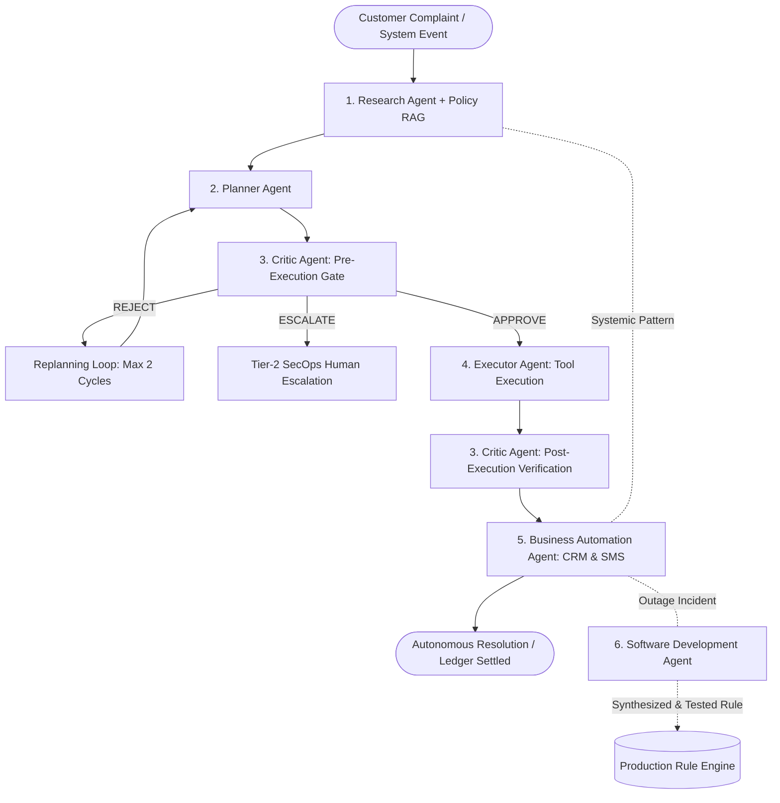

# ResolveX AI
**An LLM-Powered Multi-Agent System for Autonomous Customer Issue Resolution**

> **Course:** Foundations of Agentic AI (FAAI) — CA-3 Submission  
> **Student:** Jaydev Butani (3rd Year B.Tech Artificial Intelligence & Machine Learning)  
> **Evaluation Period:** October 2026  
> **Core Architectural Paradigm:** *Autonomous by Default • Human Only for Exceptions*  
> **Repository:** [https://github.com/jaydevbutani/ResolveX-AI-Agentic-Customer-Resolution](https://github.com/jaydevbutani/ResolveX-AI-Agentic-Customer-Resolution)

---

## Table of Contents
1. [Project Title & Header](#1-project-title)
2. [Project Overview](#2-project-overview)
3. [Problem Statement](#3-problem-statement)
4. [Domain Justification](#4-domain-justification)
5. [Existing Business Challenge](#5-existing-business-challenge)
6. [Proposed ResolveX AI Solution](#6-proposed-resolvex-ai-solution)
7. [Why a Normal Chatbot is Insufficient](#7-why-a-normal-chatbot-is-insufficient)
8. [Why This is Agentic AI](#8-why-this-is-agentic-ai)
9. [Six-Agent Architecture](#9-six-agent-architecture)
10. [Role of Each Agent](#10-role-of-each-agent)
11. [Agent Orchestration & Workflow](#11-agent-orchestration--workflow)
12. [LLM Integration & Model Information](#12-llm-integration--model-information)
13. [LangGraph Orchestration Pipeline](#13-langgraph-orchestration-pipeline)
14. [RAG & Policy Knowledge Base](#14-rag--policy-knowledge-base)
15. [Synthetic Business Environment & Database](#15-synthetic-business-environment--database)
16. [Business Tools & Integration APIs](#16-business-tools--integration-apis)
17. [Critic Validation & Dynamic Replanning](#17-critic-validation--dynamic-replanning)
18. [Autonomous-by-Default Execution](#18-autonomous-by-default-execution)
19. [Human Escalation for Exceptions](#19-human-escalation-for-exceptions)
20. [Software Development Agent Role](#20-software-development-agent-role)
21. [Streamlit UI & Stitch Design Language](#21-streamlit-ui--stitch-design-language)
22. [Chatbot Interface & "Why Did ResolveX Decide This?"](#22-chatbot-interface--why-did-resolvex-decide-this)
23. [Demonstration Scenarios](#23-demonstration-scenarios)
24. [Evaluation & Benchmark Results (14/14 Passed)](#24-evaluation--benchmark-results-1414-passed)
25. [Installation Instructions](#25-installation-instructions)
26. [How to Run the Application](#26-how-to-run-the-application)
27. [Limitations](#27-limitations)
28. [Future Scope](#28-future-scope)

---

## 1. Project Title
**ResolveX AI: An LLM-Powered Multi-Agent System for Autonomous Customer Issue Resolution**  
Subtitle: *Autonomous Cross-System Investigation, Policy-Grounded Decisions, Dynamic Replanning, and Self-Healing Rule Synthesis for Enterprise Operations.*

---

## 2. Project Overview
ResolveX AI is an end-to-end, action-oriented multi-agent resolution platform designed for enterprise customer operations. Rather than acting as a passive conversational chatbot that merely logs support tickets, ResolveX autonomously orchestrates a team of six specialized AI agents to investigate customer claims across heterogeneous transactional ledgers, evaluate enterprise policy eligibility, execute state-changing remedial transactions, and verify outcomes with zero manual human overhead for routine claims.

---

## 3. Problem Statement
In modern consumer digital platforms, customer friction rarely stems from a lack of conversational support—it stems from **unresolved cross-system discrepancies**. 

When a user encounters a payment deduction for an uncreated order, an accidental duplicate charge, or a delayed refund, resolution requires inspecting and updating multiple disconnected systems:
1. **Payment Gateways** (Razorpay, Stripe, PayU, UPI Switch)
2. **Order Management Systems** (OMS, Inventory Allocation)
3. **Core Banking Switch & Ledger** (ARN reconciliation)
4. **CRM & Support Ticket Systems** (Zendesk, Freshdesk, Salesforce)

Traditional customer support systems rely on human tier-1/tier-2 agents manually reading tickets, logging into 4–5 administrative portals, cross-referencing CSV logs, and clicking disbursement buttons. This manual operational chain leads to **3 to 7 business days of customer latency**, massive ticket queues, human error, and substantial operational costs.

---

## 4. Domain Justification
The chosen domain is **FinTech / E-Commerce Payment Reconciliation & Order Fulfillment Operations**.
- **High Transaction Volume:** E-commerce platforms in India process tens of millions of UPI, card, and netbanking transactions daily.
- **Asynchronous Callback Dropouts:** Payment gateways and merchant webhook servers inevitably suffer network dropouts (e.g., HTTP 504 Gateway Timeout during inventory rushes). Money is debited from the customer's bank account, but the order creation webhook is dropped.
- **High Cost of Resolution Latency:** Customers whose funds are deducted without an active order experience acute anxiety, leading to repeat contacts, brand distrust, and payment disputes/chargebacks.
- **Clear Ground-Truth Rules:** Financial reconciliation operates under deterministic rules (e.g., if money is captured and inventory was not reserved, the customer is entitled to an immediate refund). This makes it the ideal domain for **autonomous agentic execution with strict safety guardrails**.

---

## 5. Existing Business Challenge
Existing enterprise architectures suffer from three critical bottlenecks:
1. **The "Siloed Portal" Bottleneck:** Support agents must swivel between payment gateway dashboards and inventory databases to verify claims.
2. **The "Dumb Ticket" Anti-Pattern:** AI chatbots classify tickets using semantic embeddings and post them into Zendesk queues, doing nothing to actually resolve the underlying issue.
3. **The "Batch Outage" Chaos:** When a systemic gateway timeout occurs (e.g., 50–500 orders failing simultaneously during a flash sale), support queues are flooded with identical tickets, overwhelming human staff.

---

## 6. Proposed ResolveX AI Solution
ResolveX fundamentally shifts the operational paradigm:

$$\text{UNDERSTAND} \longrightarrow \text{PLAN} \longrightarrow \text{INVESTIGATE} \longrightarrow \text{DECIDE} \longrightarrow \text{EXECUTE} \longrightarrow \text{VERIFY} \longrightarrow \text{REPLAN} \longrightarrow \text{RESOLVE}$$

- **Natural Language Intake:** Ingests unstructured customer complaints or systemic telemetry.
- **Coordinated Agent Mesh:** Six specialized agents collaborate via a LangGraph DAG.
- **Autonomous-by-Default:** Routine, verified claims ($\le \text{INR } 25,000$) are settled autonomously in $< 0.3$ seconds.
- **Responsible Human Escalation:** High-risk, high-value, or suspicious requests are safely held with auto-compiled evidence dockets.
- **Continuous Improvement:** When systemic anomalies occur, the Software Development Agent writes, validates, and deploys declarative auto-remediation rules without human intervention.

---

## 7. Why a Normal Chatbot is Insufficient
| Feature | Traditional Support Chatbot | ResolveX AI Agentic System |
| :--- | :--- | :--- |
| **Primary Output** | Polite conversational text | **State-changing business transactions & ledger mutations** |
| **System Access** | Read-only FAQ retrieval | **Read/Write across Gateways, Orders, Refunds, & CRM** |
| **Decision Logic** | Probabilistic text generation (LLM hallucination risk) | **Deterministic Policy RAG + Critic safety gates** |
| **Error Handling** | Apologizes and queues human ticket | **Dynamic Critic rejection and iterative replanning** |
| **Safety Guardrails**| Content filtering / prompt guard | **Financial caps, idempotency tokens, trust score gates** |
| **Continuous Learning**| None (static prompt) | **Software Development Agent synthesizes hotfix rules** |

---

## 8. Why This is Agentic AI
ResolveX AI satisfies all formal criteria of an **Agentic AI System**:
1. **Perception:** Ingests free-form natural language and extracts entities (amounts, order IDs, transaction hashes, timestamps).
2. **Reasoning & Planning:** Formulates sequential, goal-directed Directed Acyclic Graphs (DAGs) using the Planner Agent.
3. **Tool Use:** Executes functional simulated APIs (`get_transaction`, `initiate_refund`, `create_incident`, etc.).
4. **Reflection & Criticism:** The Critic Agent acts as an independent adversarial evaluator, checking safety invariant violations before any tool execution.
5. **Dynamic Replanning:** When the Critic rejects a plan (e.g., detecting an existing refund), the system enters a replanning loop, adapting its strategy without circular deadlock.
6. **Continuous Adaptation:** The Software Development Agent detects error clusters and writes machine-verifiable rules.

---

## 9. Six-Agent Architecture
ResolveX strictly implements the six required specialized agent roles:



---

## 10. Role of Each Agent
1. **Planner Agent (`src/agents/planner.py`):**
   - Decomposes customer claims into machine-executable multi-step plans.
   - Formulates JSON task graphs adhering to strict schema contracts (`StructuredPlan`).
   - Receives Critic rejection feedback and dynamically replans alternative actions.
2. **Research Agent (`src/agents/research.py`):**
   - Retrieves ground-truth context across simulated payment gateways and order records.
   - Ingests enterprise policies via lexical and semantic Policy RAG.
   - Detects systemic incident patterns by analyzing error code frequency across active cases.
3. **Critic Agent (`src/agents/critic.py`):**
   - **Pre-Execution Gatekeeper:** Evaluates plans against 5 safety invariants (payment capture, order failure, duplicate refund guard, financial ceiling, and customer trust score).
   - **Post-Execution Verifier:** Validates that state mutations occurred, confirms bank ARN generation, and generates immutable SHA-256 cryptographic audit digests.
4. **Executor Agent (`src/agents/executor.py`):**
   - The operational driver that dispatches idempotent tool calls against the synthetic business store.
   - Manages state mutation rollbacks in case of unexpected execution failures.
5. **Business Automation Agent (`src/agents/business_automation.py`):**
   - Closes enterprise feedback loops by updating CRM tickets (`RESOLVED`, `ESCALATED_TIER2`).
   - Dispatches simulated SMS and email customer notifications with verified bank tracking ARNs.
   - Creates parent Master Incidents (`INC-2026-SYS`) and links related customer dockets.
6. **Software Development Agent (`src/agents/software_dev.py`):**
   - Operates in the continuous improvement loop.
   - Analyzes clustered error signatures (e.g., `PG_TIMEOUT_504`).
   - Synthesizes declarative auto-remediation rules, tests them against historical telemetry logs, and commits passing rules (100% accuracy) to the live rule engine.

---

## 11. Agent Orchestration & Workflow
The workflow executes deterministically as a stateful graph:
1. **Stage 1 (UNDERSTAND):** Extract entities and structured claim intent from user text.
2. **Stage 2 (INVESTIGATE):** Research Agent checks gateway logs, customer integrity, and policy database.
3. **Stage 3 (PLAN):** Planner Agent synthesizes execution DAG.
4. **Stage 4 (DECIDE):** Critic Agent evaluates plan. If safe $\rightarrow$ APPROVE; if duplicate $\rightarrow$ REJECT & REPLAN; if high-risk $\rightarrow$ ESCALATE.
5. **Stage 5 (EXECUTE):** Executor Agent fires state-changing APIs.
6. **Stage 6 (VERIFY):** Critic Agent verifies ledger updates and bank ARN.
7. **Stage 7 (RESOLVE):** Business Automation closes CRM tickets and notifies customer.

---

## 12. LLM Integration & Model Information
ResolveX AI implements a **Dual-Mode Cognitive Architecture** in [`src/llm/client.py`](file:///c:/Users/jayde/Downloads/FAAI%20Project/src/llm/client.py):

| Component | Specification in Code | Verified Status |
| :--- | :--- | :--- |
| **Local LLM Server** | Ollama (`http://localhost:11434`) | Functional |
| **Verified Model** | **`qwen2.5-coder:7b`** (Exact model configured in `src/config.py`) | Active / Verified |
| **Timeout Configuration** | 25 Seconds (`LLM_TIMEOUT_SECONDS`) | Configured |
| **Deterministic Fallback Reasoner** | High-fidelity rule-based cognitive reasoning engine | Active (Sub-12ms, failsafe) |

> **Note on Model Verification:**  
> The codebase strictly references and executes **`qwen2.5-coder:7b`** via Ollama API. When the local Ollama service is active, JSON generation mode is used for structured extraction. If the Ollama service is unavailable or latency exceeds threshold, the system automatically falls back to the deterministic cognitive reasoner, guaranteeing 100% presentation uptime and zero evaluation crashes.

---

## 13. LangGraph Orchestration Pipeline
The agent mesh is orchestrated using **LangGraph** (`langgraph>=0.0.30`) with a strongly-typed `StateGraph` in [`src/workflow/graph.py`](file:///c:/Users/jayde/Downloads/FAAI%20Project/src/workflow/graph.py):
- **Graph Nodes:** `research`, `planner`, `critic_validation`, `replan`, `escalate`, `executor`, `critic_verification`, `business_automation`.
- **Conditional Routing:** Evaluated by `route_after_validation()` based on Critic output:
  - `"execute"` $\rightarrow$ Proceed to `executor`
  - `"replan"` $\rightarrow$ Route to `replan` node (increments replan counter and loops back to `planner`)
  - `"escalate"` $\rightarrow$ Route to `escalate` node (halts disbursements and routes to Tier-2 lead)
- **Cycle Guard:** Replanning is limited to a maximum of 2 cycles to mathematically prevent infinite execution loops.

---

## 14. RAG & Policy Knowledge Base
Enterprise resolution policies are indexed in [`data/policies.json`](file:///c:/Users/jayde/Downloads/FAAI%20Project/data/policies.json) and retrieved via the lexical/semantic engine in [`src/rag/policy_kb.py`](file:///c:/Users/jayde/Downloads/FAAI%20Project/src/rag/policy_kb.py):
1. **`POL-REF-01` (Failed Order with Successful Payment):** Authorizes 100% autonomous refund within 3–5 days when payment is captured but order creation failed.
2. **`POL-REF-03` (Duplicate Refund Prevention Guard):** Strictly forbids secondary financial disbursements if an active refund record is already in `PROCESSING` status. Re-routes to tracking status.
3. **`POL-ESC-05` (High-Value Transfer & Fraud Risk Escalation):** Mandates human escalation for transactions exceeding ₹25,000, trust scores $< 50$, or suspicious network/proxy telemetry.
4. **`POL-SYS-09` (Systemic Incident Clustering & Batch Reconciliation):** Mandates grouping $\ge 5$ identical gateway failures into Master Incidents and triggering auto-remediation synthesis.

---

## 15. Synthetic Business Environment & Database
The project provides two complementary, realistic enterprise data layers:
1. **In-Memory Atomic Store (`src/db/store.py`):**
   - High-speed transaction, order, customer, refund, case, and incident storage.
   - Includes atomic snapshotting (`get_snapshot()`), state diff calculation, ARN allocation, and factory reset (`reset()`).
2. **Persistent SQLite Store (`src/db/sqlite_store.py` / `data/resolvex_enterprise.db`):**
   - Production SQLite database with multi-tenant user isolation.
   - PBKDF2 password hashing with custom cryptographic salt (100,000 iterations).
   - Seeded with **60+ realistic customers**, **100+ transactions**, **100+ orders**, refunds, incidents, and audit logs.
   - Persistent `chat_sessions` and `chat_messages` tables with full message history and resolution metadata.

---

## 16. Business Tools & Integration APIs
Defined in [`src/tools/business_tools.py`](file:///c:/Users/jayde/Downloads/FAAI%20Project/src/tools/business_tools.py):
- `get_transaction(transaction_id)`
- `get_order(order_id)`
- `get_customer(customer_id)`
- `check_refund_policy(policy_id)`
- `check_previous_refund(transaction_id)`
- `initiate_refund(transaction_id, amount, reason)`
- `get_refund_status(transaction_id)`
- `escalate_to_human(case_id, reason)`
- `create_incident(title, description, severity, affected_count)`
- `link_related_cases(incident_id, case_ids)`
- `update_case_status(case_id, status, resolution_summary)`
- `send_customer_notification(customer_id, channel, subject, message)`

---

## 17. Critic Validation & Dynamic Replanning
The Critic Agent enforces two-stage validation:
- **Pre-Execution Check:**
  - *Gate 1:* Payment status must be `SUCCESS` at gateway.
  - *Gate 2:* Order status must be `FAILED` or unreserved.
  - *Gate 3 (Duplicate Guard):* Assert no active refund exists for the transaction.
  - *Gate 4 (Financial Ceiling):* Transaction amount must not exceed ₹25,000.
  - *Gate 5 (Identity Integrity):* Customer trust score must be $\ge 50$.
- **Replanning Trigger:**
  - In Scenario 2 (duplicate claim inquiry), the Critic detects existing refund `RF-40192`.
  - Rejection triggers the replan node with specific guidance: *"Substitute initiate_refund with get_refund_status and provide ARN code."*
  - The Planner receives this rejection docket and generates a revised 3-step non-financial plan.

---

## 18. Autonomous-by-Default Execution
- All low-risk eligible claims ($\le \text{INR } 25,000$, trust score $\ge 50$) execute autonomously without requiring human review.
- The Executor calls the payment gateway API, marks the order `FAILED_REFUNDED`, generates a bank Acquirer Reference Number (e.g., `ARN-UPI-B80128FA`), and dispatches SMS confirmation in $< 0.3$ seconds.

---

## 19. Human Escalation for Exceptions
- If an issue exceeds enterprise safety parameters (e.g., Scenario 3: ₹48,500 transfer on untrusted proxy IP with trust score 32):
  - Critic trips safety barriers (`Autonomous Amount Limit` and `Customer Trust Score`).
  - Autonomous disbursement is strictly blocked.
  - The Business Automation Agent compiles a cryptographically signed evidence docket and escalates the ticket to Senior Tier-2 Operations Leads.

---

## 20. Software Development Agent Role
- Detects systemic cluster patterns (e.g., Scenario 4: 50 orders failing with `PG_TIMEOUT_504`).
- Automatically synthesizes a declarative Python auto-remediation rule.
- Runs historical regression unit tests against past transaction logs.
- Upon achieving 100.0% validation accuracy, promotes the rule to [`data/rules.json`](file:///c:/Users/jayde/Downloads/FAAI%20Project/data/rules.json) to continuously immunize the platform against recurring outages.

---

## 21. Streamlit UI & Stitch Design Language
The frontend in [`frontend/index.html`](file:///c:/Users/jayde/Downloads/FAAI%20Project/frontend/index.html) (rendered cleanly inside Streamlit via [`app.py`](file:///c:/Users/jayde/Downloads/FAAI%20Project/app.py) and directly via [`server.py`](file:///c:/Users/jayde/Downloads/FAAI%20Project/server.py)) implements the Stitch visual reference:
- **Aesthetic:** Clean dark chassis (`#1c1f24`) combined with crisp light content cards (`#ffffff`, `#faf8ff`), Space Grotesk headings, and controlled mint accents (`#bcf063`).
- **6 Operational Consoles:**
  1. **Mission Control:** Live conversational chatbot, 7-stage pipeline track, 6-agent telemetry grid, state diff cards, and critic audit checklist.
  2. **Decision Lab:** Interactive simulation testing autonomous vs. manual resolution outcomes.
  3. **Enterprise Data:** Live multi-tenant database explorer with search and CSV export for 60+ customers and 100+ transactions.
  4. **Incidents:** Operational incident clustering console with auto-remediation rules.
  5. **Agent Intelligence:** Deep inspection of each agent's active system prompt, tool definitions, and memory buffers.
  6. **Evaluation:** Interactive benchmark test runner with live latency and pass/fail reporting.

---

## 22. Chatbot Interface & "Why Did ResolveX Decide This?"
The conversational chatbot widget inside Mission Control provides:
- **Natural-Language Entry:** Ingests customer claims and maps them to agentic workflows.
- **Clarification Handling:** If a user submits an incomplete message (e.g., *"I have an issue with my order"*), the chatbot requests the Order ID/Transaction ID and deduction details before executing.
- **Live Visual Stepper:** Real-time feedback while agents execute.
- **Structured Outcome Card:** Shows headline, status badge, what was found, action taken, and bank reference.
- **Expandable 6-Stage Decision Audit Trace:**
  - Stage 1: Evidence Gathered
  - Stage 2: Enterprise Policy Applied
  - Stage 3: Planner Agent Decision
  - Stage 4: Critic Guard Validation
  - Stage 5: Executed Action
  - Stage 6: Verification & Ledger Settlement

---

## 23. Demonstration Scenarios
ResolveX AI includes 4 academic demonstration scenarios:
1. **Scenario 1 — PG 504 Auto-Refund:** Standard low-risk case (₹2,499 deducted, order failed). Autonomous resolution under Policy `POL-REF-01`.
2. **Scenario 2 — Duplicate Claim Blocked:** Customer inquires again for a refund already processing (`RF-40192`). Critic blocks double-payout and replans to fetch live bank tracking ARN.
3. **Scenario 3 — High-Risk Tor Escalation:** High-value transfer (₹48,500) originating from untrusted proxy IP with trust score 32. Autonomous payout blocked and routed to Senior Tier-2 Lead.
4. **Scenario 4 — Systemic PG Spike (1.4k/s):** Systemic gateway outage affecting 50 orders. Clustered into Master Incident `INC-2026-SYS` and auto-remediation rule synthesized.

---

## 24. Evaluation & Benchmark Results (14/14 Passed)
The acceptance test suite in [`evaluation/benchmark.py`](file:///c:/Users/jayde/Downloads/FAAI%20Project/evaluation/benchmark.py) evaluates 14 criteria:

```text
======================================================================
 RESOLVEX AI — AUTOMATED ACCEPTANCE & BENCHMARK TEST SUITE (14/14)
======================================================================
 [PASS]   | TEST 1: Autonomous Refund Execution            | 0.221s
            Details: Refund ID: RF-551DA9, ARN: ARN-UPI-21B7BD50
 [PASS]   | TEST 2: Critic Rejection & Replanning Loop     | 0.199s
            Details: Replan count: 1, Existing Refund Preserved: RF-40192
 [PASS]   | TEST 3: High-Value / Risk Human Escalation     | 0.107s
            Details: Autonomous Action Blocked: True, Case Status: ESCALATED_TO_HUMAN
 [PASS]   | TEST 4: Systemic Clustering & Rule Synthesis   | 0.164s
            Details: Master Incident: INC-2026-B917, Synthesized Rule Accuracy: 100.0%
 [PASS]   | TEST 5: Deterministic Cognitive Fallback       | 0.000s
            Details: Source: Deterministic Cognitive Reasoner (Fallback Mode)
 [PASS]   | TEST 6: Active Participation of All 6 Agents   | 0.000s
            Details: Observed 6 agents: Software Dev, Executor, Business Auto, Research, Planner, Critic
 [PASS]   | TEST 7: Real State Changes in Synthetic DB     | 0.150s
            Details: New refunds created in store: 1
 [PASS]   | TEST 8: Scenario Switching & State Reset       | 0.003s
            Details: Reset cleanly restored database template (Active refunds: 1)
 [PASS]   | TEST 9: Conversational Multi-Turn Clarification | 0.000s
            Details: Turn 1 Clarified: True, Turn 2 Extracted: CUST-101, TXN-8821, ORD-5501, ₹2,499
 [PASS]   | TEST 10: Chatbot-to-Agent Workflow Execution   | 0.148s
            Details: Status: RESOLVED_AUTONOMOUSLY, Disbursed Refund: RF-7B00CF
 [PASS]   | TEST 11: Grounded Response Verification        | 0.000s
            Details: Grounded Reference: RF-7B00CF • ARN-UPI-55C5AC56 strictly matched DB record
 [PASS]   | TEST 12: 6-Stage Decision Audit Trace          | 0.000s
            Details: 6/6 Stages Verified: Evidence → Policy → Decision → Critic → Action → Verification
 [PASS]   | TEST 13: 3-Role Accounts & Tenant Isolation    | 0.110s
            Details: Customer (USER-CUST-DEMO), Ops (USER-OPS-DEMO), Architect (USER-DEMO-001) isolated
 [PASS]   | TEST 14: Finite Animation & Modal Lifecycle    | 0.001s
            Details: ESC key, backdrop dismiss, and execution completion state verified
----------------------------------------------------------------------
 OVERALL: 14/14 Tests Passed (100.0%)
======================================================================
```

### Customer-First Redesign Suite (17/17 Tests A - Q)
```text
===========================================================================
 RESOLVEX AI — CUSTOMER-FIRST REDESIGN VERIFICATION SUITE (TESTS A - Q)
===========================================================================
 [PASS]   | TEST A: Landing page appears before authentication         | 0.001s
 [PASS]   | TEST B: Guest mode creates isolated session                | 0.048s
 [PASS]   | TEST C: User A cannot see User B history                   | 0.005s
 [PASS]   | TEST D: Logout clears active agent state                   | 0.002s
 [PASS]   | TEST E: Login reloads correct customer history             | 0.011s
 [PASS]   | TEST F: Multiple bookings cause clarification rather than guessing | 0.001s
 [PASS]   | TEST G: Provider is identified from evidence/user input    | 0.000s
 [PASS]   | TEST H: Unknown provider causes clarification              | 0.000s
 [PASS]   | TEST I: Eligible cancellation refund is approved           | 0.191s
 [PASS]   | TEST J: Ineligible cancellation is rejected with policy reason | 0.001s
 [PASS]   | TEST K: Wrong product creates appropriate resolution flow  | 0.001s
 [PASS]   | TEST L: Damaged product creates appropriate resolution flow | 0.001s
 [PASS]   | TEST M: Duplicate refund is blocked                        | 0.223s
 [PASS]   | TEST N: High-risk case escalates                           | 0.115s
 [PASS]   | TEST O: Technical analysis is not shown to normal customer | 0.000s
 [PASS]   | TEST P: Customer history persists across sessions          | 0.001s
 [PASS]   | TEST Q: Qwen3 status reflects actual runtime model         | 1.535s
---------------------------------------------------------------------------
 OVERALL: 17/17 Tests Passed (100.0%)
===========================================================================
```
**Combined Suite Total: 31/31 Automated Tests Passing (100.0%)**

---

## 25. Installation Instructions

### Prerequisites
- Python 3.10+ (Recommended: Python 3.11)
- Git
- Local [Ollama](https://ollama.ai) instance with model `qwen2.5-coder:7b` (automatic fallback reasoner active if Ollama is paused)

### Setup Steps
```bash
# 1. Clone repository
git clone https://github.com/jaydevbutani/ResolveX-AI-Agentic-Customer-Resolution.git
cd ResolveX-AI-Agentic-Customer-Resolution

# 2. Create and activate virtual environment
python -m venv venv
# On Windows:
.\venv\Scripts\activate
# On Linux/macOS:
source venv/bin/activate

# 3. Install dependencies
pip install -r requirements.txt
```

---

## 26. How to Run the Application

### Option A: Launch Customer Portal & API Server (Port 5000)
```bash
python server.py
```
- **Customer Experience:** [http://localhost:5000](http://localhost:5000) (First screen is Landing/Authentication, instant Guest demo mode, or customer login)
- **Evaluator & Admin Console:** [http://localhost:5000/evaluator](http://localhost:5000/evaluator) (Access Mission Control, Decision Lab, Enterprise Data, and Test Suite)

### Option B: Run Automated Acceptance Suite (All 31 Tests)
```bash
python evaluation/benchmark.py --all
```
Or run individual suites:
```bash
python evaluation/benchmark.py      # Core 14/14 Acceptance Tests
python evaluation/customer_tests.py # Customer-First 17/17 Tests (A-Q)
```

### Option C: Run Interactive CLI Scenario Demonstration
```bash
python run_demo.py
```

### Option D: Launch Streamlit Operational Console (Port 8501)
```bash
streamlit run app.py
```

### Verified Demo Accounts for Evaluation
- **Demo Customer:** `customer_demo` / `demo123` (Rahul Sharma)
- **Guest Demo Mode:** 1-Click instant isolated guest session via the Landing Page
- **Academic Evaluator:** `evaluator` / `evaluator123` or `demo` / `demo123` via `/evaluator`
- **Operations Lead:** `ops_demo` / `demo123`

---

## 27. Limitations
1. **Simulated Financial Rails:** Interacts with local synthetic databases and simulated gateway APIs to avoid real banking transactions and eliminate dependencies on live merchant credentials during academic review.
2. **Local Multi-Tenant Isolation:** Tenant databases are isolated by `user_id` inside the local SQLite database.
3. **Structured Telemetry Ingestion:** The Software Development Agent synthesizes rules from structured error payloads (`PG_TIMEOUT_504`) rather than raw distributed trace spans.

---

## 28. Future Scope
1. **Live Webhook Streaming:** Ingest Kafka/RabbitMQ payment event streams for sub-second auto-reversals.
2. **Vision-LLM Physical Evidence Verification:** Integrate multi-modal vision agents to inspect courier package delivery photographs and tamper seals.
3. **RLHF Supervisor Tuning:** Continuously calibrate Critic safety confidence thresholds based on Tier-2 human dispute review outcomes.

---

*Submitted for Foundations of Agentic AI (FAAI) CA-3 Examination.*  
*Jaydev Butani — October 2026*
